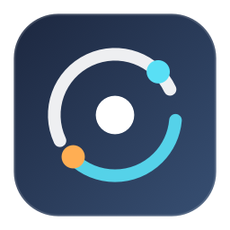
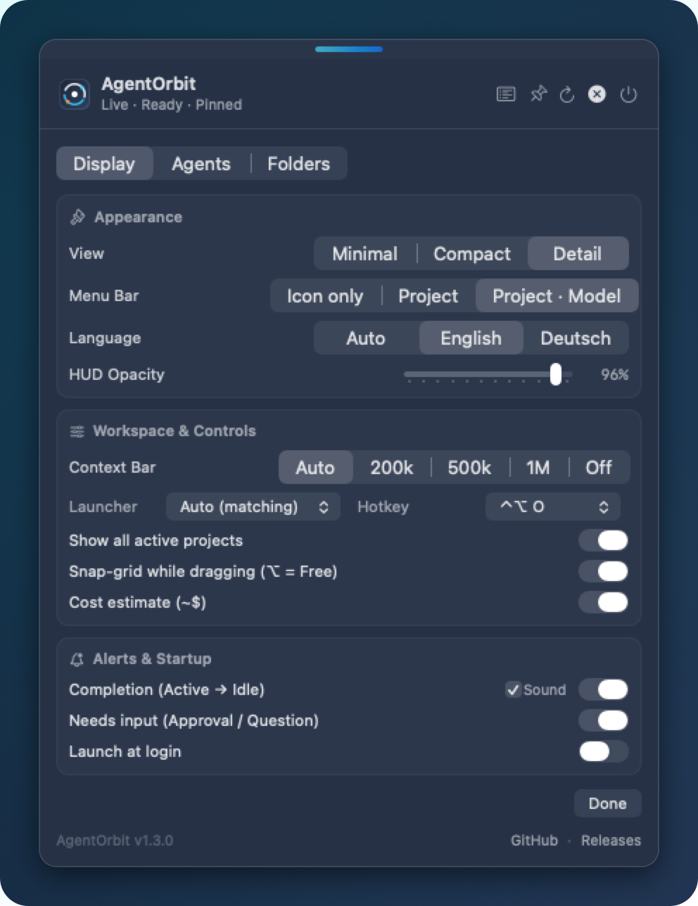

<p align="center">
  
</p>

<h1 align="center">AgentOrbit</h1>

<p align="center">
  <a href="https://github.com/SimHub/AgentOrbit/actions/workflows/ci.yml"></a>
  <a href="LICENSE"></a>
  
  
</p>

A fast, lightweight (~2 MB binary, 0 third-party dependencies, no Xcode required) macOS menu bar & floating desktop HUD for AI coding agents — reading live status, projects, Git branches, models, runtime, and usage metrics locally from **Codex**, **Antigravity**, **Claude Code**, **OpenCode**, **LM Studio Bionic**, and optional custom agents (**Pi**, etc.).

- **Project Page:** https://simhub.github.io/AgentOrbit/
- **Download Latest DMG:** https://github.com/SimHub/AgentOrbit/releases/latest/download/AgentOrbit.dmg

<p align="center">
  
</p>

<details>
<summary>Settings Preview (English / Deutsch / Auto)</summary>

<p align="center">
  
</p>

</details>

---

## Features (EN)

- **Multi-Project Live View:** Displays all running and recent (24h) sessions side by side with live status, active runtime timer (`1m 42s`, 0% CPU when idle), and menu bar parallel-session counter.
- **Responsive Desktop HUD & Snap-Grid:**
  - Pin as an always-on-top desktop widget (`⌃⌥ O` global hotkey, adjustable opacity `45%–100%`).
  - Drag freely with a live `24 pt` snap grid + 9 screen anchors (hold `⌥` for free placement).
  - Resize in 2D (`240 pt` up to full screen width, 1–3 columns, plus adjustable max list height).
- **3 View Densities:** `Minimal` (2-line corner widget, auto-enabled `< 290 pt`), `Kompakt`, and `Detail` (permanent usage & circular `Weekly` / `5h` rate-limit rings + reset timers).
- **Keyboard Shortcuts:** Choose a preset or record your own shortcut for the HUD, view switching, or showing all active projects under **Settings → Display → Keyboard Shortcuts**. AgentOrbit flags conflicting assignments.
- **1-Click Project Launcher:** Open any active project directly in **Antigravity**, **VS Code**, **Cursor**, **Terminal** (Ghostty/Warp/iTerm/Terminal), or **Finder** (plus right-click context menu).
- **Needs-Input & Completion Notifications:** Detects when Codex, Antigravity, Claude Code, OpenCode, or LM Studio Bionic pauses for user approval or a question (`Needs input` / `Eingabe nötig` orange menu bar & HUD badge) and sends native macOS notifications (+ optional sound) for both interaction requests and `Active → Idle` completion.
- **Zero-Config, Bilingual UI & Cost Estimate:** Auto-discovers installed agent directories (including deep Claude Code JSONL token/tool-use parsing), switches seamlessly between **English**, **Deutsch**, or **Auto (macOS)**, supports Launch at Login (`SMAppService`), and optionally displays exact/estimated session costs (`~$0.xx`).
- **Read-Only & Symlink-Safe:** Resolves symlinks (`resolvingSymlinksInPath`) for reliable `FSEvents` even on external SSDs and reads SQLite databases strictly read-only.

## Funktionen (DE)

- **Multi-Projekt-Übersicht:** Zeigt alle parallelen und aktuellen Sessions mit Projekt, Live-Git-Branch, Modell + Stärke, Laufzeit-Timer und Menüleisten-Counter.
- **Desktop-HUD mit Einrast-Grid:** Anpinnbar (`⌃⌥ O`), stufenlos in Breite & Max-Höhe skalierbar (`240 pt` bis Bildschirmbreite, 1–3 Spalten) mit `24 pt`-Raster & 9 Bildschirm-Ankern (`⌥` = frei platzieren) sowie einstellbarer Deckkraft.
- **3 Ansichts-Stufen:** `Minimal`, `Kompakt`, `Detail` (inkl. runder `Weekly`/`5h`-Limit-Ringe und optionaler `~$`-Kosten-Schätzung).
- **Tastenkürzel:** Unter **Einstellungen → Anzeige → Tastenkürzel** kannst du Presets oder eigene Kombinationen für das HUD, den Ansichtswechsel und „Alle aktiven Projekte zeigen“ wählen. AgentOrbit meldet doppelte Belegungen.
- **1-Klick-IDE-Starter, Wartet- & Fertig-Meldung:** Zeigt per orangem Badge + Mitteilung, sobald ein Agent auf deine Freigabe/Rückfrage wartet (`Eingabe nötig`) oder mit `Aktiv → Idle` fertig ist, und öffnet Projekte direkt im passenden Editor/Terminal.
- **Zweisprachig (EN/DE), Zero-Config & Erweiterbar:** Auto-Discovery beim Erststart (inkl. tiefem Claude Code JSONL-Support, OpenCode v2, LM Studio Bionic, Pi), umschaltbare Sprache (`Auto` / `English` / `Deutsch`) und „Bei Anmeldung starten“.

---

## Install (macOS 14+)

### Option 1 — Ask Your AI Agent (or Run 1 Command)

Tell your coding agent (Codex, Antigravity, Claude Code, OpenCode, etc.):

> *"Install AgentOrbit from `https://github.com/SimHub/AgentOrbit` using `scripts/install.sh` (or `--from-source` if I want a local build)."*

You can also run the installer directly. It currently removes the app’s quarantine attribute. For macOS’s standard first-launch checks, use the manual DMG download below.

```zsh
# Download the latest release, install it, and launch AgentOrbit
curl -fsSL https://raw.githubusercontent.com/SimHub/AgentOrbit/main/scripts/install.sh | zsh -s -- --open

# Or let an agent clone, run unit tests, compile locally from source & install
curl -fsSL https://raw.githubusercontent.com/SimHub/AgentOrbit/main/scripts/install.sh | zsh -s -- --from-source --open
```

<details>
<summary>Installer options (<code>scripts/install.sh</code>)</summary>

- `--from-source`: Clones (or uses the current repo), runs `./scripts/run_tests.sh`, compiles locally via `./scripts/build_app.sh`, and installs `AgentOrbit.app` without needing Xcode.
- `--universal`: Together with `--from-source`, builds a universal (`arm64` + `x86_64`) binary.
- `--dir <path>`: Custom target folder (defaults to `/Applications`, or `~/Applications` if `/Applications` is not writable).
- `--open`: Launches `AgentOrbit.app` immediately after installation.

</details>

### Option 2 — Manual DMG Download

Download **`AgentOrbit.dmg`** and drag `AgentOrbit.app` into `/Applications`. [GitHub Releases](https://github.com/SimHub/AgentOrbit/releases/latest)

Release builds are currently ad-hoc signed. With Apple notarization still to be set up, macOS may show a security warning on first launch.

*Die Releases sind derzeit ad-hoc signiert. Die Apple-Notarisierung steht noch aus. Beim ersten Start kann macOS deshalb einen Sicherheitshinweis anzeigen.*

---

## Build, Test & Release (Command Line Tools only)

```zsh
# Run unit tests
./scripts/run_tests.sh

# Fast, small single-arch build (~2 MB)
./scripts/build_app.sh
open ./dist/AgentOrbit.app

# Universal Binary (arm64 + x86_64) and DMG installer
./scripts/build_app.sh --universal --dmg
```

Optional build environment overrides:

```zsh
AGENTORBIT_BUNDLE_ID=dev.agentorbit.AgentOrbit AGENTORBIT_VERSION=1.0.0 ./scripts/build_app.sh
```

> [!NOTE]
> Uses only Apple system frameworks (`SwiftUI`, `AppKit`, `CoreServices`, `SQLite3`, `UserNotifications`, `Carbon`, `ServiceManagement`) — no Xcode project or external packages required.

---

## License

[MIT License](LICENSE) — Copyright (c) 2026 SimHub
