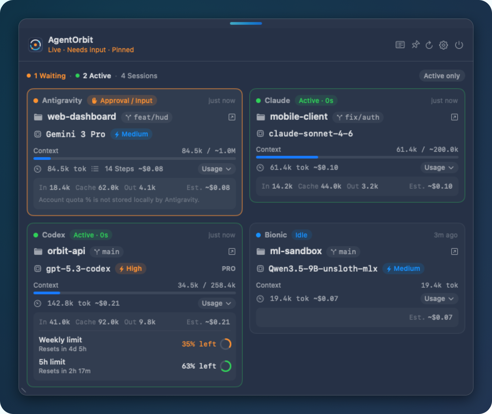

<p align="center">
  
</p>

<h1 align="center">AgentOrbit v2</h1>

<p align="center">
  <a href="https://github.com/SimHub/AgentOrbit/actions/workflows/v2-ci.yml"></a>
  <a href="LICENSE"></a>
  
  
  
</p>

A tiny, blazing-fast, **unsigned & cross-platform** (macOS, Linux, Windows) **Desktop HUD + Glass-HUD Terminal TUI** for AI coding agents — built in **Rust + Tauri v2** with **zero `node_modules`** and **~0% idle CPU**. Reads live status, projects, Git branches, models, live task checklists, runtime, ETA, and usage metrics strictly read-only from **Codex**, **Antigravity**, **Claude Code**, **OpenCode**, **LM Studio Bionic**, and optional custom agents (**Pi**, etc.).

- **Project Page:** https://simhub.github.io/AgentOrbit/
- **Releases (macOS / Linux / Windows):** https://github.com/SimHub/AgentOrbit/releases

<p align="center">
  
</p>

---

## Highlights (EN)

- **Two Native Interfaces, One Shared Rust Core (`agentorbit-core`):**
  - **Desktop HUD (`agentorbit-app`, ~8.6 MB):** Frameless native glass overlay (`14 px` rounded corners, `25%–100%` opacity with low-opacity contrast boost), system tray live badge, `24 pt` snap-grid, auto-fitting window height, and 3-tab settings (`Display | Agents | Folders`).
  - **Glass-HUD Terminal TUI (`agentorbit tui`, ~2.2 MB):** TrueColor rounded session cards (1–2 responsive columns), `M | K | D` segmented toggle, centered gradient context bars, visual circular `%` rate-limit rings, **Neovim-style navigation** (`h/j/k/l`, `gg`/`G`, `Ctrl+d`/`Ctrl+u`, `/` live search) + full **mouse click/scroll** support.
- **Instant Live Mid-Task Detection:** Immediately detects already-running tasks on launch with their true elapsed runtime (`⏱`) and live `ETA ~…` — no need to start a new task first.
- **Live Agent Checklists & Smart `✓ Done`:** Extracts live step checklists (`update_steps`, `update_plan`, `TodoWrite`) and recently edited files/commands, resets automatically on new turns, and keeps newly finished tasks visible for 5 minutes in `Active Only` mode.
- **3-Mode Project Scope & Colored Badges:** Switch between `Single`, `Active Only`, and `All` (`a` in TUI or configurable global hotkey in HUD), with color-coded agent (`AG`/`CX`/`CL`/`OC`/`LM`/`PI`) and model-family badges (Gemini, Claude, GPT/Codex, Local).
- **Layout-Aware Global Hotkeys & Notifications:** Supports QWERTZ/QWERTY keyboard layouts with conflict detection, native notifications (`Needs Input` & `Active → Done` with optional sound), and 1-click project launching.
- **Unsigned, Local & Read-Only:** No Apple Developer ID or App Store signing required. SQLite databases are opened strictly read-only; symlinks are resolved recursively for reliable watching even on external SSDs.

## Funktionen (DE)

- **Zwei native Oberflächen, ein gemeinsamer Rust-Core (`agentorbit-core`):**
  - **Desktop-HUD (`agentorbit-app`, ~8,6 MB):** Transparenter macOS-Glas-Look (`25%–100%` Deckkraft inkl. Kontrast-Boost), System-Tray mit Live-Badge, `24 pt`-Einrast-Grid, intelligente Live-Fensterhöhe und 3-Tab-Einstellungen (`Anzeige | Agents | Ordner`).
  - **Glass-HUD Terminal-TUI (`agentorbit tui`, ~2,2 MB):** Abgerundete TrueColor-Session-Karten (1–2 Spalten), `M | K | D`-Ansicht, mittige Gradient-Kontext-Balken, visuelle `%`-Ringe, **Neovim-Navigation** (`h/j/k/l`, `gg`/`G`, `Ctrl+d`/`Ctrl+u`, `/` Live-Suche) + volle **Maus-Steuerung**.
- **Sofortige Live-Erkennung laufender Tasks:** Erkennt bereits laufende Tasks direkt beim Start inkl. echter bisheriger Laufzeit (`⏱`) und `ETA ~…` – ohne erst einen neuen Task starten zu müssen.
- **Live-Checklisten & intelligentes `✓ Fertig`:** Zeigt Fortschritte aus Antigravity, Codex und Claude Code in Echtzeit an, räumt bei neuen Tasks automatisch auf und hält gerade abgeschlossene Tasks 5 Min. lang in `Alle Aktiven` sichtbar.
- **3-stufiger Projekt-Scope & farbige Badges:** `Einzeln`, `Alle Aktiven` oder `Alle`, mit farbigen Agent- & Modell-Badges, zweisprachiger UI (`Auto` / `DE` / `EN`) und optionaler `~$`-Kostenschätzung.
- **Signaturfrei & Read-Only:** Läuft komplett lokal ohne Apple-Signatur/Quarantäne auf macOS, Linux und Windows.

---

## Install (Signaturfrei / Unsigned)

### Option 1 — Local Source Install (macOS & Linux, Recommended)

Builds both `agentorbit` (CLI + TUI) and `agentorbit-app` (Desktop HUD) locally into `~/.local/bin` — **zero quarantine flags, zero Node.js, zero Xcode**:

```zsh
./scripts/install_v2.sh --open
```

Launch anytime:

```zsh
~/.local/bin/agentorbit tui       # Glass-HUD Terminal TUI
~/.local/bin/agentorbit-app &     # Floating Desktop HUD + System Tray
```

### Option 2 — Homebrew Formula (macOS & Linux)

```zsh
brew install --HEAD ./packaging/homebrew/Formula/agentorbit.rb
```

### Option 3 — Portable Binaries (macOS / Linux / Windows)

Download the portable archive for your OS from [GitHub Releases](https://github.com/SimHub/AgentOrbit/releases) (includes `agentorbit` + `agentorbit-app` + `.sha256` checksum).

---

## Terminal TUI Keybindings (`agentorbit tui`)

| Keys / Input | Action |
| :--- | :--- |
| `h` `j` `k` `l` or `←` `↓` `↑` `→` | 2D card navigation (Neovim style) |
| `gg` / `G` | Jump to first / last card |
| `Ctrl+d` / `Ctrl+u` | Half-page down / up |
| `/` | Live search (project, agent, model, branch) · `Esc` clears |
| `Enter` / `Space` / `o` | Open selected project in configured editor |
| `a` | Cycle Scope (`Single` / `Active` / `All`) |
| `f` or `1` / `2` / `3` | Filter (`All` / `Active` / `Needs Input`) |
| `m` / `c` / `d` | View density (`Minimal` / `Compact` / `Detail`) |
| `r` | Manual refresh |
| `q` / `Esc` | Quit |
| **Mouse** | Click card to select · Double-click to open · Scroll wheel · Click `M`/`K`/`D` & Scope |

Headless CLI commands: `agentorbit scan`, `agentorbit scan --json`, `agentorbit watch`, `agentorbit branch`.

---

## Build & Test from Source

Requires only a standard [Rust toolchain](https://rustup.rs/) (`cargo`) — no `npm` / `node_modules`:

```zsh
# Run all unit tests (synthetic temp fixtures only)
cargo test --workspace

# Build size-optimized release binaries
cargo build --release --workspace

# Output:
#   target/release/agentorbit      (~2.2 MB: CLI + Glass-HUD TUI)
#   target/release/agentorbit-app  (~8.6 MB: Desktop HUD + Tray)
```

*(On Linux, install Tauri v2 system libs first: `libwebkit2gtk-4.1-dev libayatana-appindicator3-dev librsvg2-dev libxdo-dev`.)*

---

## Architecture

- [`crates/agentorbit-core`](crates/agentorbit-core): Shared read-only Rust core (Codex, Antigravity, Claude Code, OpenCode v2, LM Studio Bionic, Git branch detection, `CostEstimator`, `OrbitConfig`, `notify` file watcher).
- [`crates/agentorbit-cli`](crates/agentorbit-cli): CLI + `ratatui` Glass-HUD Terminal TUI.
- [`src-tauri`](src-tauri) & [`ui`](ui): Zero-bundler Tauri v2 native desktop shell + Vanilla HTML/CSS/JS glass HUD.
- Legacy macOS-only Swift v1 remains preserved on the `v1.x` release history.

---

## License

[MIT License](LICENSE) — Copyright (c) 2026 SimHub
